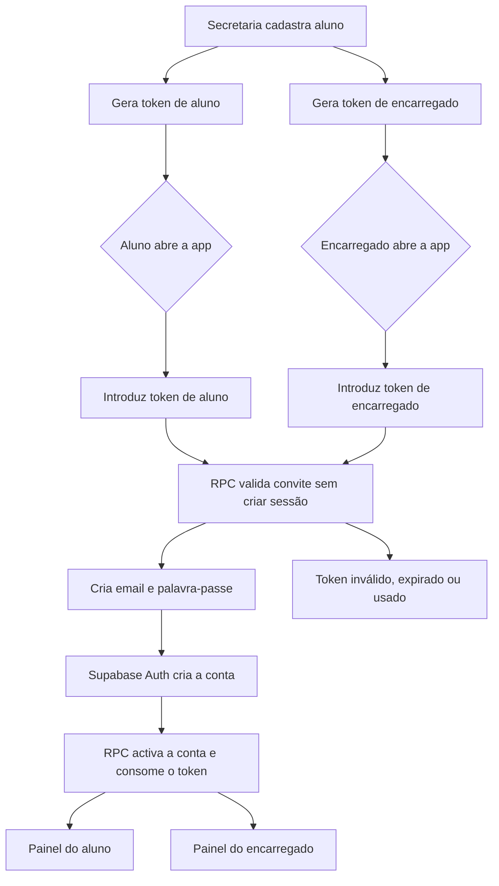

# Kulonga — fluxo de acesso por convite

## Decisão de produto

A escola emite **dois convites independentes por aluno**:

- **Token de aluno**: associa a conta do estudante ao seu registo académico.
- **Token de encarregado**: associa a conta familiar ao mesmo estudante.

O token não é uma palavra-passe e não deve abrir um painel permanente sozinho. Serve apenas para provar que a escola autorizou aquela vinculação. A sessão pertence sempre a uma conta criada no Supabase Auth.

O fluxo de professor mantém-se institucional: a secretaria pré-regista o professor e o professor activa a conta através do email institucional ou credencial temporária.

## Fluxo principal

## Regras de segurança

1. Os tokens são separados por papel; não se reutiliza um código de aluno para criar um vínculo de encarregado. Podem existir vários convites de encarregado para o mesmo aluno.
2. A RPC de pré-validação é somente leitura.
3. A RPC de activação exige `auth.uid()` e executa a vinculação numa transacção.
4. O token é consumido depois da activação e não pode ser reutilizado.
5. Tokens expirados ou já usados devolvem a mesma mensagem genérica, evitando enumeração de convites.
6. A escola pode reemitir um convite, revogando o anterior para o mesmo aluno e tipo.
7. Professores não são auto-cadastrados por tokens de aluno; continuam sujeitos ao vínculo institucional da escola.

## Estados de negócio

- `emitido`: token activo e ainda não utilizado.
- `activado`: token consumido, com `usado_por` e `usado_em` preenchidos.
- `expirado`: passou o prazo de validade.
- `revogado`: `activo = false` sem activação.

## Plano de implementação

1. Aplicar `fix-token-acesso-v2.sql` no Supabase.
2. Actualizar a secretaria para mostrar e copiar os dois códigos.
3. Usar o ecrã de convite para aluno e encarregado.
4. Manter login por email como caminho secundário para contas já activadas.
5. Testar: token válido, token expirado, token repetido, email já existente e dois encarregados para o mesmo aluno.
